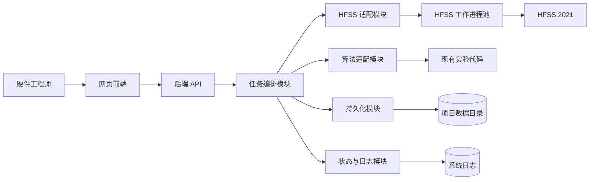
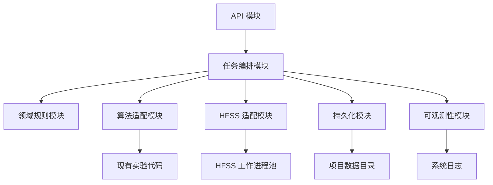
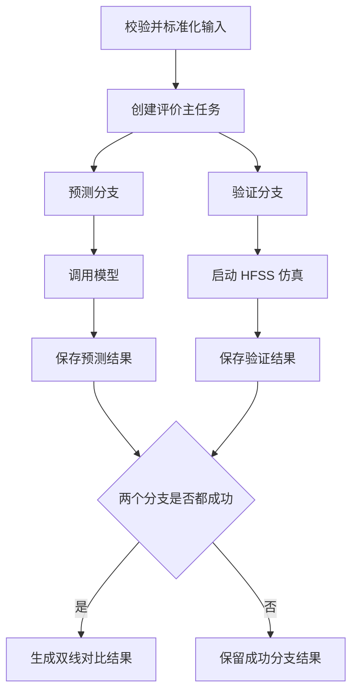

> 文件基本信息：architecture.md  
> 用途：架构基线，定义模块边界、进程、资源、ADR 和部署约束。  
> 维护：修改后同步目录索引、追踪矩阵和相关测试。  

# 非规则阵列方向图预测工具架构设计

## 1. 文档信息

| 项目 | 内容 |
|---|---|
| 文档状态 | 已审核通过，作为架构基线 |
| 文档版本 | v0.4 |
| 关联需求文档 | `requirements.md` |
| 系统类型 | 单机部署的前后端工具 |
| 运行环境 | Windows 11、HFSS 2021 |
| 主要约束 | 最多 4 个 HFSS 实例并行运行 |
| 最近更新日期 | 2026-11-23 |
| 本次更新 | 增加算法重构等价性约束、HFSSAdapter 测试替身、真实 runner 契约和服务器人工验收边界 |

## 2. 架构目标与范围

### 2.1 架构目标

- 支持用户绑定 HFSS 工程，并在点击“开始训练”后自动完成训练。
- 支持用户提交阵列输入并执行预测、验证或双模式任务。
- 避免长时间仿真阻塞前端请求。
- 支持最多 4 个 HFSS 实例并行运行。
- 持续反馈任务状态。
- 保存中间数据、结果和日志。
- 保留现有实验代码的算法逻辑。

### 2.2 架构范围

包含：

- 前端交互；
- 后端任务管理；
- 算法代码适配；
- HFSS 进程管理；
- 结果持久化；
- 日志和状态反馈；
- 数据清理。

暂不包含：

- 自动优化阵列位置；
- 详细 API 字段设计；
- 数据库表设计；
- 具体算法实现；
- 微服务拆分；
- 分布式部署。

## 3. 架构驱动因素与约束

| 类型 | 内容 |
|---|---|
| 运行环境 | Windows 11、HFSS 2021 |
| 并行约束 | 最多同时运行 4 个 HFSS 实例 |
| 性能要求 | 训练阶段多个小阵列仿真需要并行 |
| 任务特征 | 训练和验证耗时较长，预测过程较快 |
| 预测流程 | 预测使用模型，不启动 HFSS |
| 验证流程 | 验证需要启动 HFSS 仿真 |
| 状态要求 | 前端持续获取任务状态 |
| 结果要求 | 子单元结果、总阵结果和对比结果需要持久化 |
| 代码约束 | 现有实验代码通过适配方式接入 |
| 存储约束 | 使用固定的 `data/<工程名>/temp` 和 `output` 目录 |

## 4. 技术选型与架构约束

本章只记录会影响系统边界、进程关系、数据流和部署方式的技术选择。具体库版本、组件库和代码实现方式在后续设计阶段确定。

### 4.1 后端语言与运行时

- 后端语言采用 **Python**。
- 选择理由：现有实验代码和 HFSS 调用逻辑可以直接复用，便于将算法和仿真能力封装为适配模块。
- 后端 Web 框架的具体选择暂不作为本章的架构约束，只要能够提供 HTTP API、启动后台任务并运行在 Windows 11 上即可。

### 4.2 前端技术

- 前端采用 **Vue 3 + Vite**，使用轻量的 JavaScript 方案。
- 前端负责输入、任务状态展示、结果图表展示和下载。
- 前端通过 HTTP API 与后端通信，并按任务编号轮询状态。
- 具体图表库和 UI 组件库不在本章确定。

### 4.3 任务状态存储

- 任务状态和项目元数据采用 **SQLite** 保存。
- SQLite 至少保存项目、任务、模型、分支状态、当前阶段、时间信息、错误摘要和结果路径等元数据。
- 大型方向图数据、图片、模型文件和 HFSS 中间文件不存入 SQLite，仍保存到项目数据目录。
- 持久化模块对 SQLite 进行封装，避免业务模块直接依赖数据库细节。
- 应用和后台任务的致命错误写入项目数据根目录 `arraylab.log`，同时在 SQLite 保存任务/项目错误摘要。

### 4.4 HFSS 调用方式

- HFSS 的启动、工程加载、仿真提交和结果提取直接复用现有实验代码中的调用逻辑。
- 现有调用逻辑通过 `HFSSAdapter` 封装，不在 API 或任务编排模块中重复实现。
- 训练和验证分支使用 HFSS 适配模块；预测分支不启动 HFSS。
- 训练和验证共用 HFSS 工作进程池，全局最多运行 4 个实例。
- 后端允许重构实验代码的模块和调用流程，但必须保持关键业务算法、数学公式、输入输出语义、方向图数据口径和结果字段与实验参考实现一致；该等价性由架构审查 Agent 使用固定夹具和黄金数据验证。
- 开发机没有合格 HFSS 测试工程时，使用 HFSSAdapter 测试替身完成开发验证；真实 HFSS 集成验收在服务器上执行。
- 正式服务默认使用真实 HFSS 和参考预测模式。开发测试必须显式注入 `stub` 模式，不能让替身成为交付默认值。
- 真实训练/验证流程通过 runner 模块注入 `run_training(instance, project_id, task_id, context)` 和 `run_validation(instance, project_id, task_id, context)`。验证输入位于 context 的 `array_input` 字段；缺少任一函数、工程模块或训练产物时任务必须失败，禁止静默回退到替身。
- 任务编排线程不持有真实 COM 对象。默认 runner 使用 Windows `spawn` 的 `ProcessPoolExecutor` 执行 30 次训练迭代和验证仿真，每个 worker 复制绑定工程、创建独立 HFSS Desktop，完成后关闭 Desktop；数据处理、XGBoost 训练和预测在任务进程内继续执行。数据目录下的四个文件锁槽位保证跨任务全局最多四个 HFSS worker。
- HFSS 工程路径由 `createProject` 请求从前端传入，设计名称默认 `number1`，后端不把用户工程路径写入固定环境变量。随仓库提供的 `非规则阵列方向图预测项目文件/hfss.py` 只作为默认 COM 适配层。

### 4.5 技术选型边界

本章已经确定 Python、Vue 3 + Vite、SQLite 和现有 HFSS 调用方式。以下内容后续再确定：

- Python Web 框架及具体版本；
- 前端图表库和 UI 组件库；
- SQLite 表结构和索引；
- API 的详细字段和 OpenAPI 文件；
- 具体打包和启动脚本。

## 5. 系统上下文与边界



### 5.1 系统内部

- 网页前端；
- 后端 API；
- 任务编排；
- 领域规则；
- 算法适配；
- HFSS 适配；
- 持久化；
- 状态和日志管理。

### 5.2 外部依赖

- HFSS 2021；
- 用户提供的 HFSS 工程；
- 现有实验代码；
- Windows 文件系统。

## 6. 总体架构策略

系统采用：

> **模块化单体后端 + 异步后台任务 + HFSS 工作进程池。**

后端仍然是一个项目和一个主要服务进程，内部按职责划分模块。

长任务不在 HTTP 请求中同步执行，而是：

1. 接收请求；
2. 校验输入；
3. 创建任务；
4. 返回任务编号；
5. 后台执行任务；
6. 前端轮询任务状态。

暂不采用微服务、外部消息队列或复杂工作流引擎。

## 7. 模块划分与依赖关系



### 7.1 API 模块

负责：

- 接收前端请求；
- 调用输入校验；
- 创建任务；
- 查询任务状态；
- 获取结果；
- 提供下载。

不直接启动 HFSS，也不直接调用实验代码内部函数。

### 7.2 任务编排模块

负责：

- 创建和调度任务；
- 推进训练阶段；
- 管理预测和验证分支；
- 汇总分支状态；
- 触发结果合成；
- 处理失败和重试。

### 7.3 领域规则模块

负责：

- 输入合法性；
- 模型可用性；
- 任务状态转换；
- 预测和验证至少选择一个；
- 位置唯一性；
- 双模式对比生成条件。

### 7.4 算法适配模块

负责调用现有实验代码：

- 生成训练数据；
- 整理仿真数据；
- 训练模型；
- 执行模型预测；
- 生成子单元和总阵结果；
- 格式转换。

### 7.5 HFSS 适配模块

负责：

- 启动和关闭 HFSS；
- 加载 HFSS 工程；
- 提交训练仿真；
- 提交验证仿真；
- 提取仿真结果；
- 监控 HFSS 进程。
- 通过显式 runner 契约把训练数据生成、数据提取和模型训练结果回传给任务编排。训练响应至少包含可访问的 `model_path`，参考预测模式还需要 `average_pattern_path` 或服务配置中的同名产物。

### 7.6 持久化与可观测性模块

负责：

- 生成项目和任务目录；
- 保存中间数据和结果；
- 保存任务状态；
- 保存日志；
- 关联项目、任务和模型；
- 提供结果文件信息。

## 8. 运行时视图

### 8.1 训练流程

```text
绑定 HFSS 工程
    ↓
用户点击“开始训练”
    ↓
创建训练任务
    ↓
生成随机布局
    ↓
生成多个小阵列仿真任务
    ↓
HFSS 工作进程池并行执行，最多 4 个
    ↓
提取仿真结果
    ↓
整理训练数据
    ↓
训练模型
    ↓
保存模型并标记为可预测
```

### 8.2 预测流程

```text
提交阵列输入
    ↓
完成输入校验
    ↓
创建预测分支
    ↓
调用已训练模型
    ↓
生成子单元和总阵预测结果
    ↓
保存结果
```

预测分支不启动 HFSS。

### 8.3 验证流程

```text
提交阵列输入
    ↓
完成输入校验
    ↓
创建验证分支
    ↓
通过 HFSS 工作进程池执行仿真
    ↓
提取实际结果
    ↓
保存验证结果
```

验证分支使用训练任务共用的 HFSS 工作进程池，全局最多 4 个实例。

### 8.4 双模式流程



## 9. 进程、部署与资源管理

### 9.1 进程结构

- 前端运行在浏览器中；
- 后端 API 和任务编排运行在主要后端进程中；
- 后端任务编排允许使用轻量线程等待状态和提交结果，但线程不执行或持有真实 HFSS COM；
- HFSS 仿真运行在独立 HFSS 工作进程中；
- 清理任务运行在独立清理子进程中。

### 9.2 HFSS 资源限制

- 训练和验证共用 HFSS 工作进程池；
- 全局最多 4 个 HFSS 实例；
- HFSS 任务完成或失败后必须释放相关进程和资源；
- 预测任务不占用 HFSS 资源。

### 9.3 部署范围

第一版部署在单台 Windows 11 机器上，不引入多机部署和容器集群。

## 10. 数据流与持久化

### 10.1 主要数据对象

- 绑定工程项目；
- 训练任务；
- 预测任务；
- 验证任务；
- 模型；
- 阵列输入；
- 子单元结果；
- 总阵结果；
- 对比结果；
- 运行日志。

### 10.2 任务输入快照

任务创建后保存一份标准化输入快照：

- 预测和验证分支使用同一份输入；
- 任务执行过程中不受前端后续修改影响；
- 结果可以追溯到具体输入和模型版本。

### 10.3 持久化目录

```text
data/<工程名>/
├─ temp/
│  ├─ <算法中间数据目录>/
│  └─ logs/
└─ output/
   └─ <日期_任务编号>/
      ├─ 子单元预测表现/
      ├─ 总阵表现/
      └─ 数据表现/
```

具体结果目录和文件规则沿用需求文档。

## 11. 横切设计

### 11.1 状态反馈

- 后端持久化任务状态；
- 前端通过 HTTP 定时轮询；
- 任务运行期间持续查询；
- 任务进入终态后停止轮询。

### 11.2 错误处理

- 输入错误在创建任务前返回；
- 训练、预测和验证错误记录到任务状态；
- 错误信息反馈给前端；
- 调用链和详细错误写入日志；
- 双模式中一个分支失败时保留另一个分支结果。

### 11.3 并发与资源管理

- HFSS 进程池统一限制并发数；
- 训练和验证共享 HFSS 资源；
- 预测不占用 HFSS 资源；
- 不在多个模块中分别实现并发限制。

### 11.4 数据清理

系统运行时启动独立清理子进程：

- 清理超过 3 个月的项目数据；
- 清理 `temp` 和 `output`；
- 清理失败不阻断主系统；
- 下一次系统运行时再次尝试。

## 12. 架构决策、风险与验证计划

### 12.1 已确认的架构决策

| 编号 | 决策 |
|---|---|
| ADR-001 | 使用模块化单体后端 |
| ADR-002 | 长任务采用异步后台执行 |
| ADR-003 | 使用主任务管理预测和验证分支 |
| ADR-004 | 训练和验证共用最多 4 个 HFSS 实例的工作进程池 |
| ADR-005 | 前端使用 HTTP 轮询获取任务状态 |
| ADR-006 | 现有实验代码通过适配模块接入 |
| ADR-007 | 预测和验证只有都成功时才生成完整对比结果 |
| ADR-008 | 后端采用 Python，以复用现有实验代码和 HFSS 调用逻辑 |
| ADR-009 | 前端采用 Vue 3 + Vite，保持单机工具的实现轻量 |
| ADR-010 | 使用 SQLite 保存任务状态和项目元数据，大型结果仍保存为文件 |
| ADR-011 | 通过 HFSSAdapter 复用现有实验代码中的 HFSS 调用方式 |

### 12.2 主要风险

- HFSS 进程启动、终止或异常退出；
- 现有实验代码的输入输出边界需要进一步确认；
- 长任务中途失败后的恢复方式；
- 多个任务同时申请 HFSS 资源；
- 结果写盘失败；
- 本地缺少合格 HFSS 工程，部分内容只能人工验收。

### 12.3 架构验证计划

优先验证：

1. 是否能稳定启动和回收 HFSS 进程；
2. 并发运行时是否始终不超过 4 个实例；
3. 任务状态是否能持续反馈；
4. 预测和验证分支能否独立完成；
5. 双模式失败时能否保留成功分支；
6. 结果目录和任务编号是否正确；
7. HFSS 不可用时错误是否能被记录和展示。

## 13. 后续设计边界

以下内容后续单独设计：

- API 详细定义；
- 数据结构和文件格式；
- SQLite 表结构和索引；
- Python Web 框架的具体版本；
- 前端图表库和 UI 组件库；
- 代码目录结构；
- HFSS 适配接口细节。

